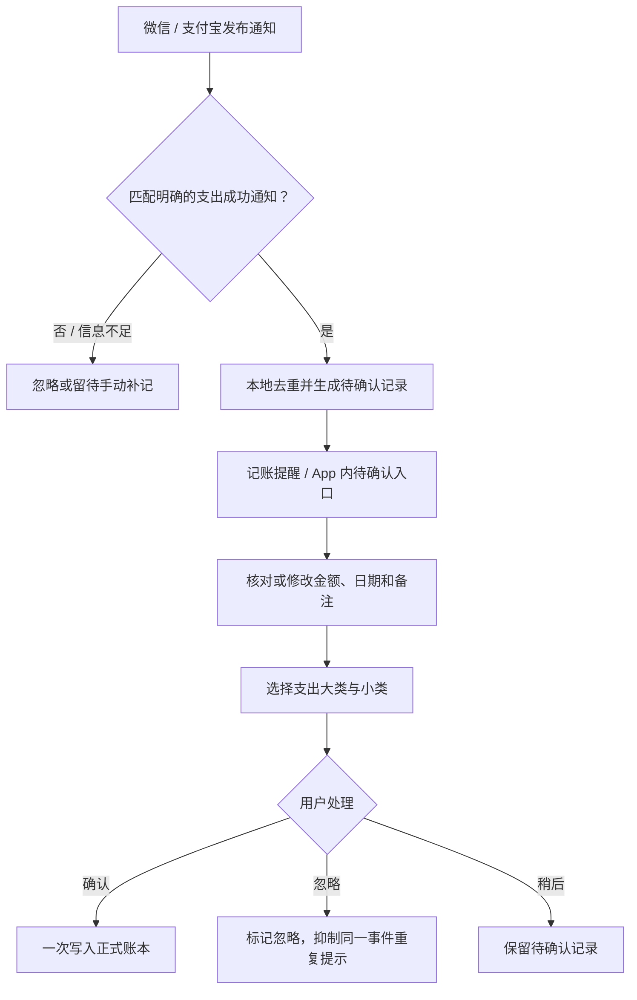

# 支付辅助记账可行性分析 v0.1

调研日期：2026-11-17。状态：讨论与技术评估，尚未纳入已确认开发范围，本轮不修改 App 代码。

## 用户已表达的方向

- 识别微信支付、支付宝的支出，收入保持手动记录。
- 希望自动识别金额，先出现记账提醒，点开金额和分类页面后允许修改、选择大类/小类、保存或忽略。
- 本地存储的原有要求延续。

## 结论

可以尝试实现“检测到明确支付通知 → 生成待确认记录 → 发记账提醒 → 人工确认入账”。不能在未验证手机与支付 App 版本之前承诺覆盖每笔付款。

核心不确定性在于信息源：支付时是否发布系统通知、通知是否包含完整的实付金额、系统是否允许读取。提醒和人工确认界面本身相对明确可实现。

## 路线比较

| 路线 | 能读取什么 | 主要限制 | 工程判断 |
| --- | --- | --- | --- |
| 通知读取 | 系统发布、且权限允许读取的微信/支付宝通知 | 没有系统通知、内容缺失或被隐藏时无法获取；重复更新需去重 | 优先验证，完成产品化为中等难度 |
| 无障碍读取支付结果页 | 系统开放的当前页面节点文本 | 对方页面可能不开放相关文本；页面升级需适配；权限范围更大，平台用途与分发政策需评估 | 较高难度，作为后续单独讨论方案 |
| 用户主动分享支付截图并本地 OCR | 用户选择的截图 | 需要多一步操作，识别可能出错 | 可选补录方式，不满足完全自动检测 |
| 商户支付回调 | 接入该商户支付系统的交易结果 | 不是读取个人跨商户所有消费的接口 | 不适合本项目作为统一监听方案 |

通知读取通过 Android `NotificationListenerService`，需用户手动授予“通知使用权”。这与本 App 发出提醒所需的通知权限是两件事，Android 13 及以上还需处理 `POST_NOTIFICATIONS`。某些安装途径及系统可能增加受限设置确认，具体需真机检查。[通知读取接口](https://developer.android.com/reference/android/service/notification/NotificationListenerService)、[通知权限](https://developer.android.com/develop/ui/compose/notifications/notification-permission)、[受限设置说明](https://support.google.com/android/answer/12623953?hl=zh-Hans)。

后台直接打开完整页面受 Android 限制；用户点击提醒再进入页面有明确的系统支持。是否显示横幅仍受通知渠道、用户设置、勿扰模式等影响，因此应保留 App 内待确认入口，不能把“横幅是否出现”作为唯一记录途径。[后台页面启动规则](https://developer.android.com/guide/components/activities/secure-bal)。

微信支付官方回调针对商户下单时设置的回调地址；支付宝 App 支付接口也向商户指定地址发送通知。由此判断，这类商户接口无法替代个人消费通知读取。[微信支付成功回调](https://pay.wechatpay.cn/doc/v3/merchant/4012791902)、[支付宝 App 支付接口](https://developer.alibaba.com/docs/api.htm?apiId=1162&docType=4)。

无障碍服务能够按系统开放能力读取页面内容，但官方将其定位为辅助工具；不能把它视作稳定的支付数据接口。[Android 无障碍服务说明](https://developer.android.com/guide/topics/ui/accessibility/service)。

## 建议的产品行为，尚待敲定

待确认项不参加本月累计、结余和 Excel 明细；正式确认后才成为账目。关闭或划掉提醒不自动表示入账。候选信息建议保存来源、识别金额、通知时间、可获得的商户文本与处理状态；不能假设通知时间就是精确支付时间。字段无法确定时不猜测填入。

隐私方面，通知使用权的系统授权范围比“仅支付”更广，软件内部的白名单不能缩小系统权限本身。建议仅处理明确选定来源，其他内容立即忽略且不持久保存；识别全在本地完成。功能默认关闭并允许随时关闭，手动记账继续可用。

## 难点与失败边界

1. **识别覆盖率**：如果付款结果只出现在 App 内，未形成系统通知，通知方案无法知道这一笔。微信和支付宝各自前台/后台、扫码付/付款码/自动扣费等场景均需实测。
2. **识别正确性**：不能只匹配“支付”与数字。需区分实付、原价、优惠、余额、待支付、失败、收款、退款和普通聊天内容。收入不生成候选；转账、红包、充值、还款是否算支出仍待确定。
3. **重复处理**：同一通知重复发布、通知内容更新、已保存或已忽略后再次收到，均需处理。不能仅凭相同金额和相近时间去重，以免吞掉真实连续付款；没有唯一交易标识时不能承诺完美去重。
4. **系统与版本差异**：通知权限撤销、服务断连、强行停止、重启和省电策略均需测试；支付 App 文案更新可能需要修改解析规则。Android 15 对含 OTP 等敏感内容的通知增加遮蔽，不应误称所有支付通知都能完整读取。[Android 15 通知保护](https://developer.android.com/about/versions/15/behavior-changes-all#otp-redaction)。
5. **人工补记与候选重叠**：如果用户已手动记账后才收到候选，不能无提示自动重复写账；相似记录只能作为人工判断提示。

## 对现有工程的影响

现有 0.1.2 仍为手动记账，Manifest 未配置通知读取或发送提醒的权限。若正式开发，需要新增系统通知服务、微信/支付宝分开的解析规则、待确认数据与状态、提醒入口、确认入账页面和权限状态页；Room 数据库与本地备份格式均需规划兼容升级。已有正式账目与待确认信息应分开保存，确认操作需要事务与幂等保护。

首轮建议先做不写正式账本的验证版本，在实际手机验证“有没有通知、能否读到、能否准确提取实付金额”。用用户自愿发生的正常付款测试，不需专门制造消费。将结果分为“无通知/不可读、可读但无法可靠解析、可解析”，分别统计检测覆盖、金额正确性、误报和重复情况。

只有信息源验证通过，再开发提醒、金额修改、分类选择与确认流程，并验证忽略、稍后、重启、重复通知、权限关闭。当前没有真机识别测试结果，不给出成功率或固定工期承诺。

尚待补充：实际手机型号和 Android 版本、微信/支付宝版本、需要覆盖的付款场景；转账/红包/充值/还款的纳入规则。以上可在下一轮或真机验证时确定。
