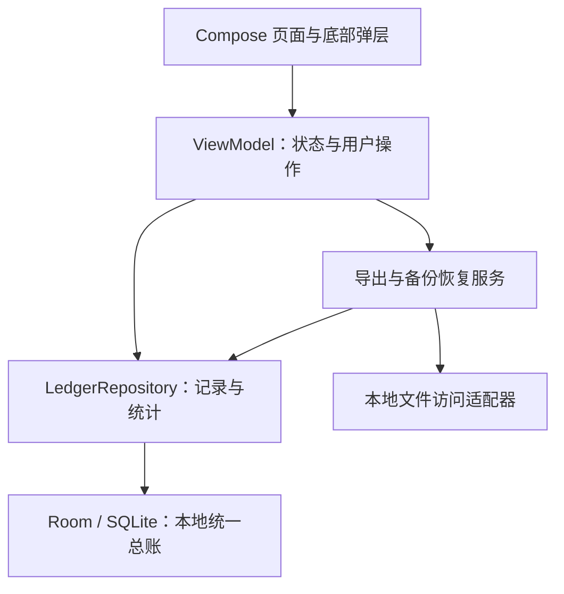

# 技术方案与开发计划 v1.0

日期：2026-11-17。

状态：已按用户授权进入开发，当前进度与证据见[阶段成果 M0 / M1](阶段成果-M0-M1.md)。本文件保留原阶段规划，实际调试改为用户后续连接的安卓手机，不限定品牌。依据：[已确认需求 v1.1](首版需求确认单-v1.1.md)。

开工前补充审查见[缺失点审查 v1.0](开工前缺失点审查-v1.0.md)：历史月份、误选小类后撤销新增、日期时间规则待选择，其他交互与文件使用规格待补齐；审查建议不自动改变已确认范围。

## 1. 推荐方案

采用原生安卓开发：**Kotlin + Jetpack Compose + ViewModel / StateFlow + Room 本地数据库**。当前只明确安卓与后续连接的安卓手机，原生路线便于统一处理本地存储、系统文件操作、安装升级和真机性能。

| 部分 | 建议 | 用途 |
| --- | --- | --- |
| 语言与界面 | Kotlin、Jetpack Compose | 实现已选的紧凑分区、黑白红、圆角与底部弹层 |
| 界面状态 | AndroidX ViewModel、StateFlow、协程 | 数据变化后更新首页、明细和结余，处理后台文件操作 |
| 本地数据 | Room / SQLite | 统一保存记录和分类，提供事务、查询和升级迁移 |
| 页面导航 | AndroidX Navigation，使用兼容的稳定版 | 记账、明细、设置与各二级页面 |
| 文件选择 | Android Storage Access Framework | 由用户选择导出和备份位置、选择待恢复文件 |
| Excel | 独立导出适配器，M0 验证后锁定实现 | 严格生成已采用的两张表和 11 列固定格式 |
| 备份 | 带版本与校验信息的逻辑备份 | 保存记录、分类和设置，全量恢复 |
| 工程构建 | Gradle Wrapper、Kotlin DSL、统一版本目录 | 固定可复现的构建环境与依赖组合 |

界面层与数据层分开、通过 Repository 访问数据、用 ViewModel 和数据流管理界面，参考 [Android 官方架构建议](https://developer.android.com/topic/architecture/recommendations)。Room 是官方提供的 SQLite 抽象，支持本地持久化与迁移；参考 [Room 指南](https://developer.android.com/training/data-storage/room)。上表是结合本项目范围的选型建议，不表示官方要求所有项目采用完全相同的结构。

具体 Android SDK、JDK、Kotlin、Compose、Room 与插件版本在 M0 根据稳定版兼容矩阵锁定，记录到工程文件。当前规划不预先拼接未经构建验证的版本号。

## 2. 借鉴成熟流程的方式

采用“小批次可运行交付 + 持续验证 + 阶段完成条件”的流程。

| 借鉴内容 | 在本项目中的落地 |
| --- | --- |
| 需求基线与变更登记 | 以 v1.1 为依据；新增功能记录影响到的页面、数据、验证与阶段 |
| Android 分层与单向数据流 | 数据库是记录的权威来源，界面展示观察到的状态 |
| 先验证不确定技术 | Excel、备份恢复和构建环境在 M0 做最小验证 |
| 逐步交付可运行版本 | M1 提供首个功能体验 APK，此后逐阶段完善 |
| 分层测试 | 计算规则在本机验证，数据库与界面在安卓环境验证，最终在后续连接的安卓手机 验收 |
| 可复现构建与发布 | 固定工具版本；保留 schema、迁移、构建命令、签名和版本记录 |

首版使用一个 App 主模块，按职责分包；仅在复杂恢复、导出等流程需要复用时提取业务操作。测试方法参考 [Android 测试基础](https://developer.android.com/training/testing/fundamentals)。

## 3. 架构与工程组织



- 首版可用一个 Repository 统一协调分类、记录和统计，复杂流程另设服务；使用构造参数传递依赖，方便测试。
- 所有保存、修改、删除和恢复通过统一数据入口执行，界面不直接写数据库。
- 本月收支、各大类金额、结余来自一致的查询结果；结余不作为收入记录存储。
- 导出与备份使用固定数据快照，金额处理与筛选规则复用，不各算一套。
- 文件读写与批量操作在后台执行，界面显示进度和明确的成功、取消或失败状态。

建议工程放在当前项目的 `android/` 下：

```text
android/
  app/src/main/.../
    ui/           # 首页、输入、分类弹层、明细、设置与管理页面
    data/         # Room 表、查询和 Repository
    core/         # 金额、日期范围、统计与固定模板定义
    transfer/     # Excel、备份、恢复与文件访问
    app/          # 入口、导航、依赖组装
  app/src/test/         # 本机规则与文件格式验证
  app/src/androidTest/  # 安卓数据库与关键界面流程验证
  gradle/               # Wrapper 与版本目录
docs/                    # 需求、设计和阶段记录
```

以上是计划目录，本轮不创建源码工程。

## 4. 开发顺序与阶段完成条件

| 阶段 | 主要工作 | 交付给用户的结果 | 完成条件 |
| --- | --- | --- | --- |
| M0 环境与技术验证 | 定位或准备 JDK / SDK；构建最小安卓工程；验证真实 `.xlsx` 输出和备份恢复事务；补齐剩余页面交互规格 | 环境与版本记录、验证结论、二级页面规格 | 最小 APK 可构建并在安卓环境运行；文件格式、写入与恢复路线验证通过，未决项有明确处理结论 |
| M1 首个功能体验版 | 最小分类创建、紧凑首页、金额输入、日期备注、小类弹层、本地保存、本月汇总与结余 | 第一个可安装的功能体验 APK | 从空数据开始建类并记账，重启后仍在，正零负结余与补记月份正确 |
| M2 管理与明细 | 分类改名、排序、停用和启用；全量与分类明细、筛选、编辑、删除确认和 5 秒撤销 | 可长期管理记录的体验版 | 操作后归属和累计一致，停用保留历史，编辑不改变记录 ID |
| M3 导出与备份恢复 | 固定 Excel、筛选导出、手动备份、保护当前数据、确认恢复、异常回滚 | 功能范围完整的候选版 | 导出与手机数据核对一致；备份往返一致；异常与取消不破坏当前数据 |
| M4 真机回归与性能 | 按 A01—A22 回归；核对实际设备键盘、系统栏、文件选择、字体放大和深色系统设置下的既定视觉；启动与较多记录测试 | 真机验证记录、缺陷处理结果 | 数据与恢复问题解决，关键流程通过，发布包启动实测达到需求目标；未达到的项目保留为未完成 |
| M5 发布与交付 | 正式签名、安装与覆盖升级、源码构建复核、使用说明 | 签名 APK、源码、构建安装说明、验证结果 | 同包名同签名升级保留数据，可复现构建，未完成项清晰列明 |

每阶段边实现边验证；M4 集中执行完整回归，不是首次测试。M0 可以使用模拟器或已连接安卓设备；后续连接的安卓手机 特有的体验与最终验收在真机上完成。

日程在 M0 明确下载、构建及设备验证条件后估算；本规划先按可验收成果安排顺序。

## 5. 两个前期验证项

### 5.1 Excel 导出

优先评估 Java 的 fastexcel 写入组件，其项目文档提供数值、日期、表格和冻结窗格等功能示例，见 [fastexcel 项目说明](https://github.com/dhatim/fastexcel/blob/master/README.md)。**该说明不是 Android 兼容承诺，是否采用取决于 M0 的安卓构建、运行及混淆后验证。**

验证必须覆盖：两张表、11 列顺序、中文与空备注、可计算金额、原生日期、收入红字、表格筛选、冻结表头、空数据，以及批量导出。生成文件与现有样表语义一致，并用独立解析器和 Excel 实际打开核对。

若组件存在兼容或依赖负担问题，评估使用平台 ZIP / XML 能力实现本项目固定模板需要的 SpreadsheetML 子集；标准结构参考 [Microsoft SpreadsheetML 文档](https://learn.microsoft.com/en-us/office/open-xml/spreadsheet/structure-of-a-spreadsheetml-document)。替代方案也必须通过同样的文件验证。M0 最终只保留一种实现，不让未决组件进入正式功能开发。

### 5.2 备份与恢复

采用带格式版本、记录数量与文件校验的逻辑备份。先验证“备份 → 恢复 → 再读取”的往返一致，并在插入中途模拟失败，验证数据库事务回滚。

正式恢复流程为：**选择文件 → 校验并预览 → 备份当前数据且验证副本可读 → 用户确认 → 单次事务恢复 → 刷新界面**。在保护当前数据到恢复完成期间暂停新的写入；不在等待用户确认时长期占用数据库事务。

恢复方案详见[数据设计](数据设计与验收映射-v1.0.md)，这是必须先验证的完整性要求。

## 6. 验证、性能与完成标准

- 计算验证：分转元、禁止多位小数、月边界、补记、分类变更、正零负结余、删除和撤销；以明确的预期数据验证结果。
- 数据库验证：外键、唯一名称、事务、持久化、停用历史、迁移；用真实安卓 SQLite 验证关键行为。
- 文件验证：重新打开生成的 Excel / 备份，对比笔数、分类 ID、时间与每类收支合计；对空文件、损坏、未来版本和写入失败做针对验证。
- 关键界面验证：大类入口与明细入口独立；点小类只保存一次；金额键盘、底部弹层、返回、筛选和恢复确认按规格运行。
- 设备验证：以后续连接的安卓手机 的实际 Android / HyperOS 版本记录结果，离线执行核心功能；辅助检查字体放大及不同内容宽度。

性能以发布配置包测量，记录首次安装启动、冷启动与热恢复，分别报告首帧和首页数据就绪可操作时间。使用官方 [启动指标](https://developer.android.com/topic/performance/issues/launch-time) 与 [Macrobenchmark 方法](https://developer.android.com/topic/performance/benchmarking/macrobenchmark-overview)，需求目标为冷启动可操作不超过 2 秒、热恢复不超过 1 秒。

测试数据规模建议为 0、1,000、10,000 笔，含跨月与同名小类；每个主要启动场景建议重复至少 10 次并记录中位数、P90 和最大值，首次安装单独报告。建议以 P90 满足冷启动 2 秒、热恢复 1 秒作为主要判断，同时记录设备、系统、数据量和测量条件。优化依据实测结果，例如减少主线程工作、延后文件组件加载；需要时再加入 Baseline Profile。

一个任务完成需同时具备：行为符合需求、相关验证通过、无已知数据丢失或金额错误、阶段记录更新。缺陷修复后复核相关路径；通过后按阶段推进，不重复运行无变化的全部检查。

## 7. 当前开发环境与准备事项

2026-11-17 只读检查结果：

| 项目 | 当前观察 | 后续动作 |
| --- | --- | --- |
| Java | PATH 中为 Java 1.8.0_451 运行环境，未发现 javac 命令 | 为选定 Android 工具链定位或准备兼容 JDK |
| SDK / IDE | 常见 Android Studio 和 SDK 路径未发现；未设置 ANDROID_HOME / ANDROID_SDK_ROOT | M0 先定位已有安装，再确定所需组件 |
| adb / Gradle | PATH 未发现相应命令 | adb 随 SDK 定位；项目使用 Gradle Wrapper |
| Git | 已有 Git 命令；当前尚非安卓源码工程 | M0 建立本地版本管理和忽略规则，不默认连接或推送远端 |
| 项目路径 | 当前目录含中文 | M0 先验证该路径的完整构建与打包 |
| 后续连接的安卓手机 | 实际系统版本和调试连接尚未核实 | 在设备准备时核实；记录到真机验证材料 |

以上不是全盘扫描，不代表电脑上没有其他位置的安装。JDK 需按选定插件兼容要求统一，参考 [Android JDK 配置说明](https://developer.android.com/build/jdks)。本轮没有下载或安装环境，也没有改动系统环境变量。

## 8. 安装、数据与发布

- 核心数据保存在 App 私有本地数据库，App 不加入网络业务依赖；文件操作使用系统文件选择器。官方说明 SAF 可按用户选择访问文档，见 [文件访问指南](https://developer.android.com/training/data-storage/shared/documents-files)。
- 为落实不使用云端，配置关闭系统自动云备份，并按目标系统配置数据提取排除规则；文件选择请求本地文件。具体系统行为纳入安卓真机验证，依据 [Auto Backup 文档](https://developer.android.com/identity/data/autobackup) 和 [本地文件选择说明](https://developer.android.com/guide/components/intents-common)。
- 稳定包名、签名与版本号作为升级基础；签名密钥由用户长期保管，密钥和密码不写入源码。安装和更新需要 APK 签名，依据 [Android 签名说明](https://developer.android.com/studio/publish/app-signing)。
- 保留数据库 schema，后续结构变化提供迁移并验证已有记录，依据 [Room 迁移指南](https://developer.android.com/training/data-storage/room/migrating-db-versions)。
- 测试数据与正式数据隔离，调试包与正式包的迁移通过已验证的完整备份恢复处理；正式版本覆盖安装验证数据保留。

## 9. 本轮需要审阅的内容

本轮不再重复确认已通过的功能。主要看：

1. 原生安卓技术路线是否符合你的预期。
2. M0 先验证环境、Excel 和恢复，M1 给出功能体验包的开发顺序是否合适。
3. 每阶段的交付物和完成条件是否便于你检查。

App 正式名称、图标与具体工具版本不会阻塞本轮计划审阅；名称与图标在正式交付前完成。计划审阅后先推进 M0，不把“规划完成”视为“软件已开发完成”。
