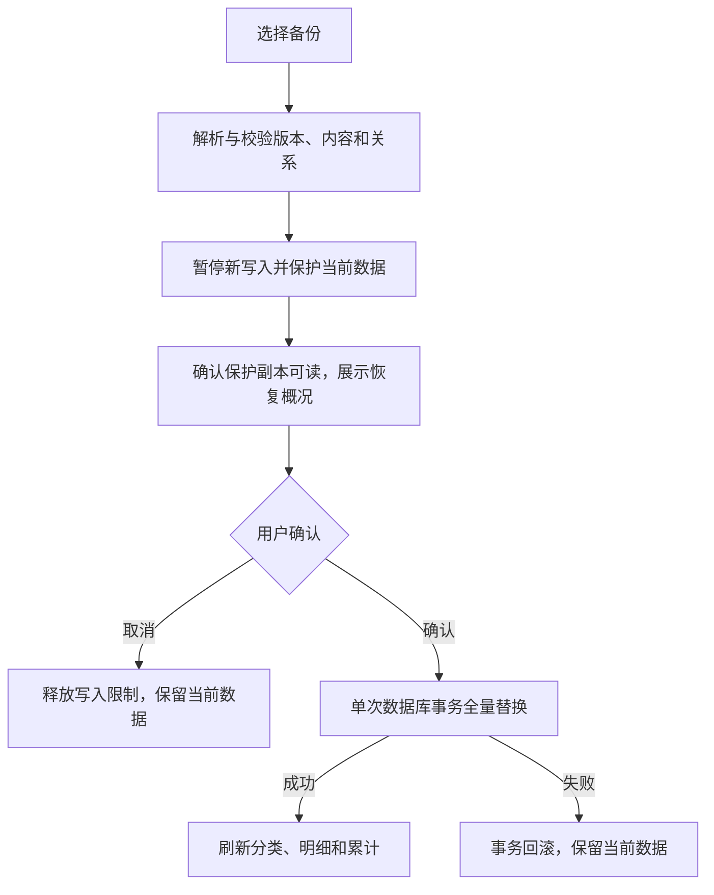

# 数据设计与验收映射 v1.0

日期：2026-11-17。状态：技术设计草案，随[开发计划](技术方案与开发计划-v1.0.md)审阅，尚未实现。

## 1. 不变的业务口径

- 统一总账；大类决定收入或支出；每个小类只属于一个大类。
- 一笔记录归入一个小类，并由此获得大类与收支类型，避免重复保存三处不一致的归属。
- 记录金额是正数；收入、支出分开汇总；结余＝收入－支出，不是额外收入。
- 统计、筛选、导出共用实际发生日期与相同的分类规则。
- 停用只影响新增入口，不抹掉历史；删除记录不进入普通统计与导出。

## 2. 金额、时间与统计

| 事项 | 设计建议 |
| --- | --- |
| 存储金额 | `Long` 整数分；例如 128.00 元为 12800 分 |
| 输入金额 | 通过十进制精确校验转分，拒绝零、负数、超过两位小数与超出允许范围的输入；不先经过浮点乘法 |
| 汇总金额 | 整数累加并处理溢出；展示和导出时再转为元，明示单笔上限与批量上限的技术边界 |
| 发生时间 | 保存用户指定的本地日期时间，默认当前值；统计直接使用记录的发生日期 |
| 创建 / 更新时间 | 实际操作时间戳，不用补记日期覆盖 |
| 月范围 | 起点包含当月 1 日，终点不包含次月 1 日；日期选择范围包含完整结束日 |
| 汇总读取 | 从同一次一致查询或读事务得到各大类金额和收支合计，再计算结余 |
| 空数据 | 收入、支出和结余均为 0.00，明细为空，不用虚构记录补齐界面 |

用注入的时钟测试月初、月末、跨年和撤销期限，测试不依赖真实等待。发生日期与实际创建时间分开，避免补记或设备时区调整将历史记录重新归入其他月份。

Excel 中的金额和日期按既定样表写为可计算的原生数值，备注按文本写入。输入不走浮点记账运算，Excel 中的显示保留两位小数；对大额边界也做独立解析复核。

## 3. 数据表草案

| 表 | 主要字段 | 约束与用途 |
| --- | --- | --- |
| `category_groups` | `id`、`name`、规范化名称、`direction`、`sortOrder`、`isActive`、创建/更新时间 | UUID 稳定 ID；大类名称唯一；方向为收入或支出；有历史记录后不直接切换方向 |
| `categories` | `id`、`groupId`、`name`、规范化名称、`sortOrder`、`isActive`、创建/更新时间 | 外键到大类；同大类内名称唯一；不同大类允许同名 |
| `entries` | `id`、`categoryId`、`amountMinor`、`occurredLocalDateTime`、`note`、创建/更新时间、删除状态与期限、提交去重标识 | 外键到小类；金额为正整数分；稳定 ID；提交去重标识唯一 |
| `app_settings` | 必要设置键、值与更新时间 | 仅存实际需要的设置，同库便于完整事务恢复；不新增用户未提出的设置功能 |

- 记录不重复存储小类名称、大类名称和收支方向，查询时关联获取当前名称与归属。
- 分类改名保留 ID，历史展示与导出随名称更新。
- 停用大类时通过可用性条件隐藏其小类，不覆盖每个小类原本的启用状态。
- 为发生时间、小类与时间组合、大类关联建立必要索引；明细使用稳定排序与分批加载。
- 不增加多账本、云端账号或同步表。
- 导出 schema 并保留版本；升级迁移通过测试后启用，不使用清空数据重建来代替正式迁移。[Room 迁移依据](https://developer.android.com/training/data-storage/room/migrating-db-versions)

表与字段名为设计草案，M0 编译 schema 后固定；业务含义不能因命名变化而改变。

## 4. 写入、编辑与删除

### 保存一次

1. 点大类后创建本次输入的提交标识。
2. 金额确定后只更新输入状态，未生成正式记录。
3. 点小类后进入提交状态，临时禁用重复提交。
4. 数据层校验大类和小类仍可用，使用去重约束完成一次事务写入。
5. 成功后由数据库变化更新界面并回首页；失败保留输入，可修正后重试同一提交。

### 编辑与分类

- 编辑先读取原记录；修改大类时重新选择目标大类的小类，收支性质随目标大类确定。
- 原分类停用时允许保留原归属，仅修改金额、日期或备注；切换只展示可用分类。
- 一次事务更新记录，保持原记录 ID 与创建时间，刷新更新时间。
- 更新后重查受影响月份与分类统计，避免只加减当前可见数字导致累计偏差。

### 删除与撤销

- 用户确认后将记录标为已删除，立即从普通明细、统计、导出和逻辑备份快照排除。
- 5 秒内可清除删除标记，恢复原 ID 与内容；过期后可清理已删除行。
- 撤销能力只针对本次删除窗口，非长期回收站。
- 若期间 App 被终止，重启后已确认删除的记录仍保持删除状态；不得因清理尚未执行而重新出现。
- 恢复备份属于独立流程，不使用单笔撤销窗口。

## 5. 导出契约

以[已采用样表](../outputs/requirements-20261117/记账导出样表-v0.1.xlsx)为准：两张工作表，11 列明细，金额为元、时间为本地显示，固定收入/支出语义，不增加结余明细行。

执行过程：冻结本次筛选条件 → 获取一致数据快照 → 在私有临时文件中完整生成并检查 → 通过系统文档访问写入用户选择的位置 → 关闭流后报告结果。

- 分类名称与记录在同一快照读取，防止导出中途改名导致同一文件混用名字。
- 收入和支出合计用于验证，不插入明细合计行。
- 中文、空备注、特殊字符、看似公式的备注均作为正确类型导出。
- 空结果导出保留表头和导出说明，明示笔数为零。
- 用户取消、存储空间不足、目标失效或写入失败时报告未成功；不把不完整目标文件当成可恢复备份。
- 对取消、失败残留的处理以实际文档提供者能力为准，M0 验证；不声称系统提供者具备通用原子写入。
- 文件选择使用系统 SAF，按本地文件要求配置；[Android 文件访问指南](https://developer.android.com/training/data-storage/shared/documents-files)说明了创建与打开文档的机制。

## 6. 备份格式与恢复状态机

建议备份为 ZIP 容器，包含 `manifest.json` 与 `data.json`；扩展名在 M0 固定，文件名包含本地生成时间。格式与数据库内部 schema 解耦。

`manifest.json`：备份格式版本、App 数据版本、创建时间、各类数量与数据校验值。

`data.json`：当前有效记录、完整大类与小类、停用状态、排序和必要设置；金额以整数分表达，ID 与时间精度不丢失。文件副本与预恢复备份不再次嵌套进数据备份。

校验值用于检测文件损坏，不作为真实性签名或备份加密功能。首版不额外引入账户、云服务或备份密码流程。

### 手动备份

在一致读快照中取数 → 生成临时文件 → 校验可读与数量 → 写入用户选定的本地位置 → 成功关闭后显示结果。

### 全量恢复

具体约束：

1. 先校验文件结构、已支持版本、数量、金额、日期、唯一 ID、分类关系与允许的设置值；未知未来版本不写入当前数据。
2. 当前数据保护副本保存在独立的本地预恢复目录，不随导入覆盖；至少保留最近一份成功副本。新保护副本成功后才替换旧副本。
3. 预恢复副本可在现有备份恢复页面中导出或选用，避免生成后用户无法访问。
4. 保护当前数据到最终确认、恢复完成期间阻止其他新增或编辑，保证保护副本包含替换前最新状态；等用户确认时不保持长数据库事务。
5. 用户确认后才进入短时数据库写事务，按外键依赖替换所有业务数据和必要设置；失败回滚整体事务。
6. 保护副本失败或无法验证可读，则不进入最终替换。取消、校验失败或替换失败时当前数据完整保留。
7. 恢复成功后读取数据库重建界面状态，不沿用恢复前的缓存合计与旧输入。

## 7. 本地范围与升级

- App 不接入云端业务服务。系统自动备份属于另一机制，因此显式关闭云备份并配置目标系统的数据提取排除规则，真机核对实际行为。[Android Auto Backup 依据](https://developer.android.com/identity/data/autobackup)
- 用户主动导出的备份和 Excel 使用本地文档位置；请求 `EXTRA_LOCAL_ONLY`，其含义参考 [系统文件 Intent 说明](https://developer.android.com/guide/components/intents-common)。
- 记录数据保存在私有数据库，预恢复副本在独立本地目录，不随业务数据恢复覆盖。
- 稳定应用标识、正式签名、递增版本号；迁移与覆盖安装一起验证。签名规则参考 [Android 签名指南](https://developer.android.com/studio/publish/app-signing)。

## 8. 验收映射

所有条目目前均为“待实现 / 待验证”。以下定义未来需要的证据，不是现有通过记录。

| 需求验收 | 对应阶段 | 主要验证方式与证据 |
| --- | --- | --- |
| A01 安装启动 | M0、M1、M4、M5 | 构建记录、APK 版本与小米安装运行记录 |
| A02 首次空数据 | M1 | 首次安装状态、创建分类流程；不得带示例金额 |
| A03 恋爱支出 | M1 | 128 元闭环操作与数据库、首页、明细一致 |
| A04 收入 | M1 | 100 元收入只增加收入合计，红色表现正确 |
| A05 同名小类 | M1、M2 | 个人与恋爱各自饮食的管理、归属与导出核对 |
| A06 卡片明细 | M1、M2 | 独立入口的导航验证，不产生输入记录 |
| A07 补记上月 | M1、M3 | 月边界与实际创建时间的规则验证、导出复核 |
| A08 金额与取消 | M1 | 十进制边界、空值、零负数、小数位数、取消路径 |
| A09 防重复 | M1 | 连点与重试后记录数量为一的数据库证据 |
| A10 修改 | M2 | 跨月、跨类、跨收支修改后的累计与稳定 ID |
| A11 删除撤销 | M2 | 删除确认、5 秒窗口、过期、重启后的状态 |
| A12 分类管理 | M2 | 改名、排序、停用、重新启用与历史保留 |
| A13 明细筛选 | M2 | 日期端点、分类组合、收支与倒序结果 |
| A14 Excel 格式 | M0、M3 | Android 实际生成、独立解析、Excel 打开与样表比较 |
| A15 导出对账 | M3 | 同一快照内记录数、每类及总收支核对，含停用历史 |
| A16 完整备份 | M0、M3 | 所有业务数据与设置的备份往返一致 |
| A17 全量恢复 | M0、M3 | 当前保护副本、明确确认、全量替换且不合并 |
| A18 恢复异常 | M0、M3、M4 | 损坏、未来版本、保护失败、取消、中途写失败的原数据保留 |
| A19 离线重启 | M1—M5 | 离线核心操作与重启持久化，文件提供者行为记录 |
| A20 正式包升级 | M4、M5 | 发布包启动数据、同签名覆盖升级后的原数据 |
| A21 结余显示 | M1、M4 | 6,140.00 示例计算；正零负值，字号层次与位置 |
| A22 结余联动 | M1—M4 | 变更、撤销、恢复与补记后的结余，数据库和 Excel 无额外收入行 |

对金额、备份、恢复、升级和文件格式等影响正确性的路径保留自动验证；简单文案和可逆样式调整采用检查与必要的界面复核，不为每个展示细节编写重复测试。

## 9. 阶段记录格式

每次阶段交付记录：关联需求编号、完成内容、可安装包或其他可检查产物、验证设备与版本、已执行检查和结果、尚未通过或未验证的内容、下一阶段动作。

数据丢失、重复入账、金额或月份错误、恢复破坏当前数据、正式安装与升级失败属于阶段交付前必须解决的问题。未完成的设备专有验证明确保留为待验证，不用浏览器原型结果代替真机结论。
